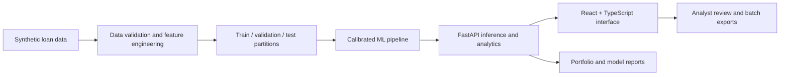

# Nyanja Credit Risk Intelligence

A full-stack credit-risk analytics and machine-learning research platform built around a fictional Malawian commercial bank and an entirely synthetic loan-application dataset.

The project is designed to demonstrate the end-to-end lifecycle of an applied machine-learning product: synthetic data engineering, model development, calibration, model evaluation, subgroup diagnostics, API engineering, interactive analytics, batch inference, containerisation and deployment preparation.

> **Synthetic-data notice:** Every borrower, application, branch outcome and financial record in this repository is simulated. The project does not contain real customer or bank data. Model outputs are not validated for real lending and must never be used to approve, decline or price real credit.

## Product workspaces

### Portfolio intelligence
- Portfolio volume, observed default rate and requested exposure.
- Breakdown by branch, customer segment and loan purpose.
- Application volumes and simulated default rates.
- All values are loaded from the committed synthetic dataset through the API.

### Application assessment
- Editable synthetic application profile.
- Calibrated probability estimate and descriptive risk band.
- Configurable human-review flag.
- Fold-wise logistic feature contributions on the uncalibrated log-odds scale.
- Derived affordability features are recalculated when key inputs change.

### Batch analysis
- CSV-based batch inference for up to 500 applications per request.
- Row-level schema validation and error reporting.
- Downloadable scored results.

### Model governance
- Held-out test metrics: ROC-AUC, PR-AUC, Brier score, log loss, precision, recall, specificity and F1, with stratified bootstrap 95% intervals.
- Fixed-width probability calibration diagnostics with observed default rates and Wilson intervals.
- Lightweight model metadata registry with active/archived status, artifact and dataset SHA-256 fingerprints, training metadata and held-out metric summary. Artifact-file archival and model rollback are not implemented.
- Validation-selected review threshold and review rate.
- Confusion matrix.
- Subgroup diagnostics for gender, age bands, employment status, customer segment and branch.
- 95% Wilson intervals and suppression of small groups.
- Explicit model limitations and demographic feature governance.

## Architecture



### Technology

| Layer | Technology |
|---|---|
| Frontend | React, TypeScript, Vite |
| Visualisation | Recharts |
| Backend | FastAPI, Pydantic |
| Database | PostgreSQL, SQLAlchemy |
| Machine learning | Scikit-learn, calibrated Logistic Regression |
| Data processing | Python, Pandas, NumPy |
| Explainability | Logistic coefficient contribution analysis |
| Testing | Pytest, Ruff, TypeScript build |
| Delivery | Docker, Docker Compose, Nginx |
| CI | GitHub Actions |

The existing Streamlit application, notebooks, tree-based models and earlier analysis remain in the repository as research assets. The new application is being developed alongside them.

## Run the full platform

Requirements: Docker Engine and Docker Compose.

```bash
docker compose build
docker compose up -d
```

Open:
- Frontend: http://localhost:8080
- API: http://localhost:8000
- Interactive API documentation: http://localhost:8000/docs
- Health: http://localhost:8000/health

The API image builds a fresh v2 model from the committed synthetic raw dataset. The training process writes the model artifact, model metadata, validation-selected threshold and evaluation report into the image.

Stop the services:

```bash
docker compose down
```

See [DEPLOYMENT.md](DEPLOYMENT.md) for environment configuration and public deployment preparation.

## Run components separately

### API

```bash
python -m venv .venv
source .venv/bin/activate
pip install -r requirements-api.txt
python scripts/train_model_v2.py --output-dir models/v2
python scripts/run_temporal_validation.py --output-dir models/temporal
alembic upgrade head
uvicorn api.main:app --reload
```

Apply database migrations before starting the API with `alembic upgrade head`. The API verifies the migrated schema at startup and does not create production tables automatically.

The API expects the generated artifact at `models/v2/credit_risk_calibrated_v2.joblib` and the synthetic portfolio CSV at `data/raw/loan_applications_synthetic.csv`.

### Frontend

```bash
cd frontend
npm install
VITE_API_URL=http://localhost:8000 npm run dev
```

## Model development protocol

The v2 training workflow is implemented in [scripts/train_model_v2.py](scripts/train_model_v2.py). A separate synthetic chronological stress-test is implemented in [scripts/run_temporal_validation.py](scripts/run_temporal_validation.py) and documented in [docs/TEMPORAL_VALIDATION.md](docs/TEMPORAL_VALIDATION.md).

1. Remove exact duplicate records before partitioning.
2. Create stratified training, validation and final test partitions.
3. Learn winsorisation caps from training data only.
4. Apply the same caps to validation and test data.
5. Fit preprocessing inside the model pipeline.
6. Exclude direct demographic fields from predictive model inputs.
7. Calibrate probabilities using cross-validation inside the training partition.
8. Select a review threshold on validation data under an explicit review-capacity constraint.
9. Evaluate the selected model and threshold once on the held-out test partition.
10. Save model artifact, metadata and evaluation report.

A separate temporal experiment assigns 36 synthetic months, simulates a macro-stress shift, uses whole-month train/validation/future-test partitions, and reports month-level future performance. Its dates, stress values and outcomes are simulated, not observed Malawi banking data.

The final test metrics are not used to select the model or threshold.

### Subgroup diagnostics

Demographic and segment fields are retained for post-hoc auditing. The report includes observed default rates, model review rates, recall, false-positive rates, precision and 95% Wilson intervals. Groups below the minimum sample size are suppressed.

Removing direct demographic fields does not establish fairness. Proxy variables, sampling effects, data quality, uncertainty and operational impacts still require scrutiny.

### Explainability

The application reports mean fold-wise logistic coefficient contributions. Contributions are expressed on the uncalibrated log-odds scale. They are not probability-point changes, causal effects or an explanation of the calibration mapping.

## Data

The fictional dataset represents a simulated Malawi-oriented commercial lending context. It includes employment and customer segments, loan purposes, branch labels, loan terms, affordability ratios, credit history and a binary simulated default outcome.

The data generator and original methodology are retained in:
- `src/generate_data.py`
- `data/raw/loan_applications_synthetic.csv`
- `data/processed/loan_applications_clean.csv`
- `notebooks/loan_default_risk_analysis.ipynb`

The synthetic target is generated from a probabilistic risk function. The resulting patterns are properties of the generator, not empirical claims about Malawi's banking sector.

## API endpoints

| Method | Endpoint | Purpose |
|---|---|---|
| GET | `/health` | API, model and portfolio readiness |
| GET | `/api/v1/model` | Model metadata and feature governance |
| GET | `/api/v1/model/evaluation` | Held-out metrics, bootstrap intervals, calibration bins and subgroup diagnostics |
| GET | `/api/v1/model/temporal-evaluation` | Future-window synthetic comparison of baseline, logistic and random forest models |
| GET | `/api/v1/model/registry` | Registered model versions, artifact fingerprints and active status |
| GET | `/api/v1/portfolio/summary` | Synthetic portfolio summary |
| GET | `/api/v1/portfolio/breakdowns` | Branch, segment and loan-purpose summaries |
| GET | `/api/v1/assessments/sample` | Synthetic example application |
| POST | `/api/v1/assessments` | Single application inference |
| POST | `/api/v1/assessments/explain` | Inference with model contribution explanation |
| POST | `/api/v1/assessments/batch` | Batch inference |
| GET | `/api/v1/audit/summary` | Aggregate metadata-only assessment audit |

## Quality checks

```bash
pip install -r requirements-api.txt pytest pytest-cov ruff
ruff check api src/models/schema.py scripts/train_model_v2.py tests/test_api.py tests/test_model_governance.py
pytest tests/ --cov=src --cov-report=term-missing
```

Frontend production build:

```bash
cd frontend
npm install
npm run build
```

GitHub Actions runs the Python quality checks and frontend build on changes to the platform branch and pull requests into the default branch.

## Repository map

```text
api/                    FastAPI service
frontend/               React + TypeScript application
src/data/               Data loading, validation and preprocessing
src/features/           Feature engineering
src/models/              Model training and feature governance
src/evaluation/          Evaluation and calibration utilities
src/explainability/      Explainability and fairness research modules
scripts/                 Reproducible training and analysis commands
tests/                   Automated tests
data/raw/                Synthetic source dataset
data/processed/          Cleaned synthetic dataset
models/                  Existing model artifacts and reports
docs/                    Platform roadmap and design documentation
```

## Current delivery status

- [x] Repository audit and separate development branch.
- [x] Platform roadmap and architecture direction.
- [x] Governed v2 feature schema.
- [x] Train/validation/test training workflow.
- [x] Calibrated model training and validation threshold selection.
- [x] Subgroup diagnostics with uncertainty intervals.
- [x] FastAPI inference, portfolio and batch endpoints.
- [x] Local logistic contribution explanations.
- [x] React portfolio, assessment, batch and governance workspaces.
- [x] Dockerfiles and Docker Compose configuration.
- [x] Python and frontend CI checks configured.
- [x] Confirm green CI across the latest branch head.
- [x] Run and verify the complete Docker Compose stack.
- [x] Add PostgreSQL persistence for metadata-only assessment audit events.
- [ ] Add formal model registry lifecycle.
- [x] Add versioned PostgreSQL schema migrations.
- [ ] Complete security review and production deployment.
- [ ] Publish a presentation-ready technical case study.

## Responsible-use statement

This repository is an educational and portfolio project. It is not a credit bureau, lending product or validated risk model. Do not use its predictions for real people, real lending, credit pricing, eligibility, collections or other consequential decisions.
